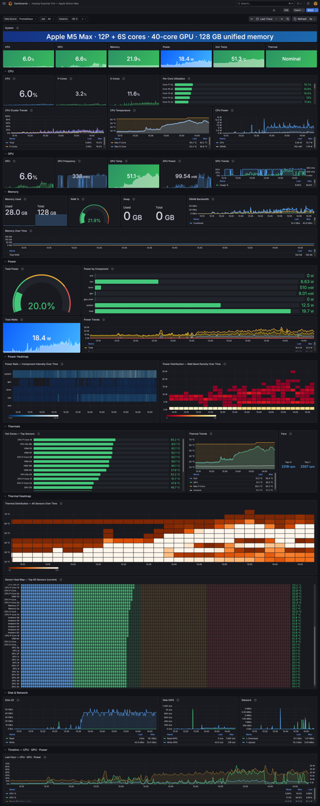

# mactop Exporter — Grafana Dashboard

A comprehensive [Grafana](https://grafana.com/) dashboard for **Apple Silicon Macs**, built on top of [mactop](https://github.com/metaspartan/mactop) — a Prometheus metrics exporter for Apple Silicon.

## Features

49 data panels across 9 sections:

| Section | What you get |
|---|---|
| **CPU** | Per-core utilisation, cluster utilisation (P-cores · E-cores · S-cores), cluster trends & thermals |
| **GPU** | GPU utilisation, GPU frequency |
| **Memory** | RAM & swap usage, compressed memory, memory pressure, memory bandwidth |
| **Power** | Per-rail wattage (CPU · GPU · ANE · DRAM · System · Total), AC status and adapter rating |
| **Power Heatmap** | Component intensity over time + watt-band distribution heatmap |
| **Thermals** | Available SMC temperature sensors |
| **Thermal Heatmap** | Temperature distribution over time + top-60 sensor bar gauge |
| **Disk & Network** | Read/write throughput, network in/out, listening ports |
| **Timeline** | Combined CPU · GPU · Power sparkline history |

## Requirements

- [mactop](https://github.com/metaspartan/mactop) **v2.1.6+** running and scraping into **Prometheus**
- **Grafana 10+** (tested on 12.4.0)

## Installation

1. In Grafana, go to **Dashboards → Import**
2. Upload `mactop_exporter_v1.json`
3. Select your Prometheus datasource
4. Click **Import**

## Metric compatibility

- Tested against mactop v2.1.6. Network metrics have reported KiB/s since v2.1.4. The dashboard multiplies them by 1024 to display bytes/s. Older versions require the previous network queries.
- RAM, compressed memory and swap values are displayed in GiB.
- Fan RPM and adapter wattage use -1 for unavailable readings, displayed as Unavailable.
- Memory pressure includes the kernel level and an approximate 0–100 score.
- Listening-port counts reflect processes visible to mactop. External counts include bindings beyond localhost.
- Sensor counts, names and availability vary by hardware and macOS version.
- Instance selection supports multiple hosts. Capacity and temperature maxima are shown per host.

## License

MIT — see [LICENSE](LICENSE)
